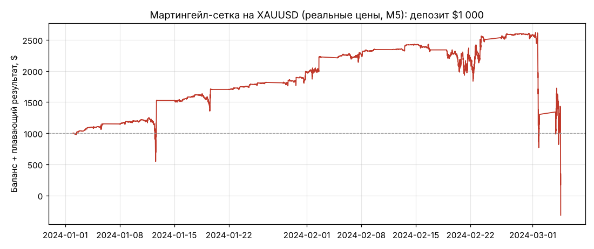

# Мартингейл и сетка: как устроены и почему умирают

Разбор того, что стоит за «ахуенными» кривыми сигналов на MQL5 / cTrader Copy: механика на числах, прогон на реальных ценах
золота, разбор живого случая (Pro Scalper) и проверка на 10 годах истории, можно ли сделать такую схему прибыльной.

Здесь только анализ и выводы. Торгового робота и подбора настроек в репозитории нет.

## 1. Логика одной фразой
«Если цена пошла против меня, я не закрываю убыток, а докупаю больше, чтобы закрыться в плюс на маленьком откате».

* **Сетка** — ордера через равные интервалы цены (часто одинаковым лотом).
* **Мартингейл** — каждый следующий ордер больше предыдущего (обычно ×2), чтобы один отскок отбил всё.
* Чаще всего их совмещают.

## 2. На числах (золото по $2000, 0.01 лота = 1 унция, шаг $10, лот ×2, выход на $5 выше средней)

| Шаг | Цена | Новый ордер | Всего лотов | Средняя цена | Плавающий минус | Нужен отскок | Прибыль при закрытии |
|---|---|---|---|---|---|---|---|
| 1 | 2000 | 0.01 | 0.01 | 2000.0 | $0 | +$5.0 | $5 |
| 2 | 1990 | 0.02 | 0.03 | 1993.3 | −$10 | +$8.3 | $15 |
| 3 | 1980 | 0.04 | 0.07 | 1985.7 | −$40 | +$10.7 | $35 |
| 4 | 1970 | 0.08 | 0.15 | 1977.3 | −$110 | +$12.3 | $75 |
| 5 | 1960 | 0.16 | 0.31 | 1968.4 | −$260 | +$13.4 | $155 |
| 6 | 1950 | 0.32 | 0.63 | 1959.0 | −$570 | +$14.0 | $315 |
| 7 | 1940 | 0.64 | 1.27 | 1949.4 | −$1 200 | +$14.4 | $635 |
| 8 | 1930 | 1.28 | 2.55 | 1939.7 | −$2 470 | +$14.7 | $1 275 |
| 9 | 1920 | 2.56 | 5.11 | 1929.8 | −$5 020 | +$14.8 | $2 555 |
| 10 | 1910 | 5.12 | 10.23 | 1919.9 | **−$10 130** | +$14.9 | $5 115 |

* Средняя цена всё время подтягивается к текущей, поэтому даже после падения на $90 хватает отскока на ~$15 —
  отсюда 90–99% прибыльных сделок и ровная кривая.
* Размер позиции растёт экспоненциально: депозит $1 000 умирает на 6–7-м шаге, т.е. после движения против на ~3% без отката.
  Для золота это обычный день-два в тренде.
* По сути это **продажа страховки от тренда**: каждый день маленькая премия, а когда тренд наступает — выплата всего сразу.

## 3. На реальных ценах
Простейшая сетка с мартингейлом на XAUUSD (M5, шаг $6, множитель ×1.6, депозит $1 000) с 1 января 2024:
**101 цикл подряд в плюс, $1 000 → $2 600 за два месяца, затем 4 марта 2024 — ноль за один день.**

## 4. Почему «выруливает» — не умение
Если исход каждого шага примерно 50/50, проиграть 7 раз подряд — 1 шанс из 128: **99.2% цепочек выруливают сами**.
При 2–3 цепочках в день одна невыруленная случается раз в 1.5–2 месяца; пару таких счёт переживает (минус половина),
потом приходит та, после которой ноль. Умение может сдвинуть частоту катастрофы (не торговать в новости, выбирать боковик),
но не её неизбежность. Проверка: сделки базовым лотом, до удвоений — если они сами по себе не в плюс, вся «прибыль» от схемы.

## 5. Как распознать по истории сигнала
1. Средний проигрыш в разы больше среднего выигрыша при 85–95% прибыльных сделок.
2. Лот скачет в 5–100 раз, особенно после убытков (видно даже по комиссиям: 0.06 → 0.12 → 0.24 → 0.48 → 1.92).
3. Нет стопов (SL/TP пустые).
4. Убыточные позиции висят часами и днями, прибыльные закрываются за минуты.
5. Встречные позиции одновременно («лок»).
6. Просадка по средствам (equity) намного глубже, чем по балансу; в min/max equity видны глубокие провалы.
7. Крошечный счёт автора против огромных денег копировщиков; ROI в сотни тысяч процентов.

## 6. Случай Pro Scalper (cTrader Copy, XAUUSD)
* ROI «+183 12…%» меньше чем за 10 месяцев, деньги инвесторов $497k от 147 человек, баланс автора ~$1 100, комиссия 30%.
* В истории: лот растёт ступенями ×2/×4 (комиссии 0.06/0.12/0.24/0.48/1.92), стопов нет, продажи держались ночь (13 ч)
  и перекрывались встречной покупкой; одна сделка на самом большом лоте сняла 13% баланса; за апрель 69% сделок убыточны.
* График средств: «пила» — медленный рост и обрывы (часть — убытки с провалом equity, часть, вероятно, вывод прибыли),
  финальный обвал в ноль в начале апреля 2025. Кто подключился на пике — потерял 50–100%.

## 7. Можно ли сделать прибыльным: проверка на 10 годах
36 вариантов (шаг $5/$10/$20, множитель ×1/×1.5/×2, максимум доливок 5/8/12/без лимита со стопом корзины),
каждый запущен 36 раз с разных дат 2017–2025, депозит $1 000, спред и комиссия учтены, до слива или 12 месяцев.

| Настройка | Слился за год | Прожил (медиана) | В плюсе через год | Средний итог из $1 000 |
|---|---|---|---|---|
| самый «живучий»: шаг $10, ×1.5, макс. 5 со стопом | 39% | 12 мес | 53% | $923 |
| чистая сетка: шаг $10, ×1, макс. 5 | 36% | 12 мес | 39% | $925 |
| классика: шаг $10, ×2, без лимита | 89% | 1 мес | 11% | $453 |
| агрессивно: шаг $5, ×2, 12 доливок | 92% | 0.4 мес | 8% | $1 660 (пара «выстреливших» запусков) |

**Вывод:** живучесть покупается доходностью, а в среднем теряют все варианты. Мартингейл не создаёт преимущества — он только
переставляет риск (много мелких выигрышей против редкого огромного проигрыша), а спред на каждой доливке и лёгкая инерция
цены на коротких интервалах делают ожидание отрицательным. Красивые счета в рейтингах — выжившие из лотереи.
